# Rental Management: Zoho Creator + CRM + Books

A working **Zoho Creator** application for a fictional property rental business, connected to **Zoho CRM** and **Zoho Books**. Staff book stays in Creator. Deluge prices each booking, blocks double bookings and enforces a status lifecycle. Every booking appears in CRM as a Deal, a deal lost in CRM cancels the booking, and a completed stay is invoiced in Books automatically.

> **Status:** deployed and tested in real Zoho accounts (Creator, CRM, Books). 53 test cases ran against the live apps and 52 passed. The remaining one (L01, delivery of the booking email) is waiting for the owner to confirm the copy in their inbox ([results](TEST_RESULTS.md)). All sample data is fictional.

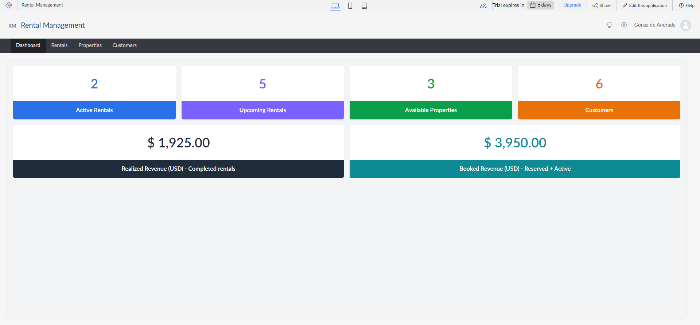

## How the apps work together

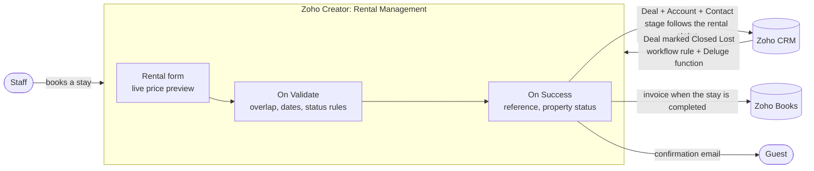

| When this happens | The system does this | Where |
|---|---|---|
| A rental is saved | Calculates nights and total, blocks overlaps and invalid status changes | Creator (Deluge, *On Validate*) |
| A rental is saved | Creates or updates its **CRM Deal**, with the customer as Account and Contact. The Deal stage follows the status (Reserved → Negotiation/Review, Completed → Closed Won, Cancelled → Closed Lost) | Creator → CRM |
| A new booking is made | Emails the guest a confirmation, with a copy to the owner | Creator |
| A salesperson marks the Deal **Closed Lost** | Cancels the reserved rental in Creator, so the dates are free again, and leaves a note on the Deal | CRM workflow rule + function → Creator API |
| A stay is **Completed** | Creates the **Books invoice** (customer, nights × rate) and stores its number on the rental | Creator → Books |

## What this project demonstrates

| Skill | Where to look |
|---|---|
| Creator data model: forms, lookups, unique/mandatory fields, reports, ZML dashboard page | [DATA_MODEL.md](DATA_MODEL.md), [`app/src/RentalManagement.template.ds`](app/src/RentalManagement.template.ds) |
| Deluge business rules: validation, calculations, status lifecycle, overlap queries | [`rental_validate.dg`](app/src/deluge/rental_validate.dg), [BUSINESS_RULES.md](BUSINESS_RULES.md) |
| Deluge integration tasks: `zoho.crm.*`, `zoho.books.*`, `zoho.creator.*`, `sendmail`, with `try/catch` and idempotency (no duplicate Deals or invoices) | [`crm_sync.dg`](app/src/deluge/crm_sync.dg), [`books_invoice.dg`](app/src/deluge/books_invoice.dg), [`booking_email.dg`](app/src/deluge/booking_email.dg) |
| Zoho CRM development: custom function, workflow rule, connections with minimal OAuth scopes, Notes | [`app/crm/deal_closed_lost.dg`](app/crm/deal_closed_lost.dg) |
| Two-way sync without loops (each side ignores changes that are already applied) | [BUSINESS_RULES.md](BUSINESS_RULES.md#zoho-crm-sync) |
| The application as source code: built from a template and versioned in Git | [`app/build.mjs`](app/build.mjs) |
| Automated end-to-end testing against the live apps (Playwright) | [TEST_PLAN.md](TEST_PLAN.md), [TEST_RESULTS.md](TEST_RESULTS.md), [`automation/`](automation/README.md) |

## Screenshots

| | |
|---|---|
| 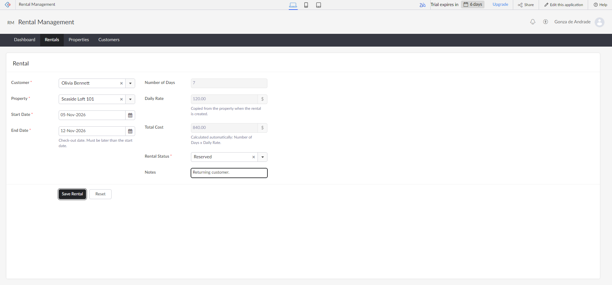 **Live calculation**: rate copied from the property, days and total calculated | 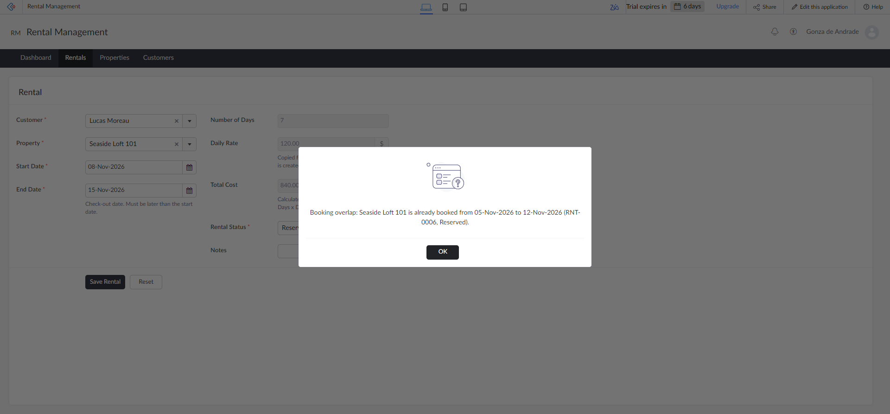 **Overlap blocked** with a clear message |
| 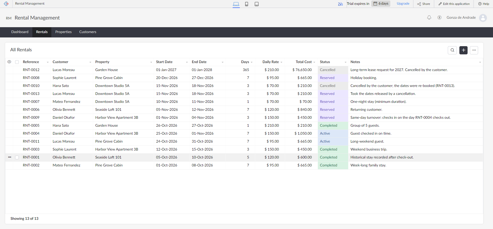 **All Rentals**, colour-coded by status | 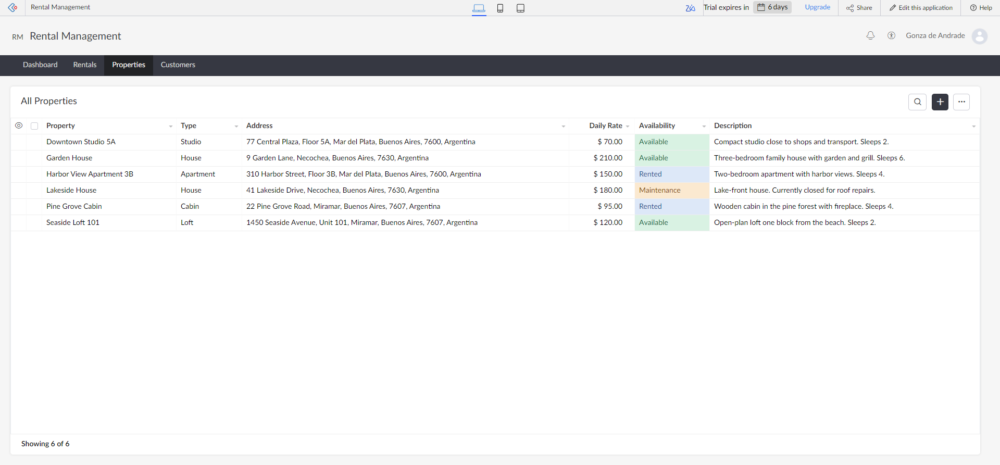 **Properties**: availability updated automatically |
| 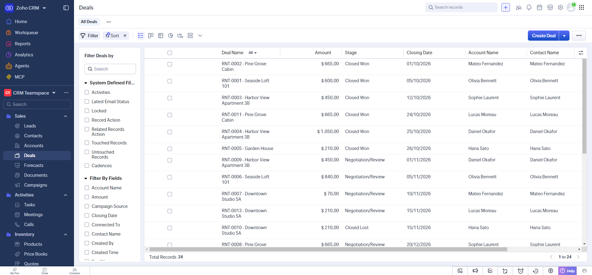 **Zoho CRM**: one Deal per rental, with amount and stage | 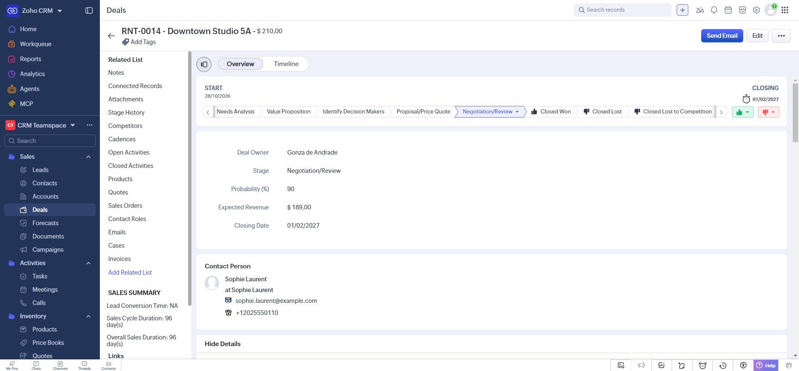 **CRM Deal** linked to the customer's Contact |
| 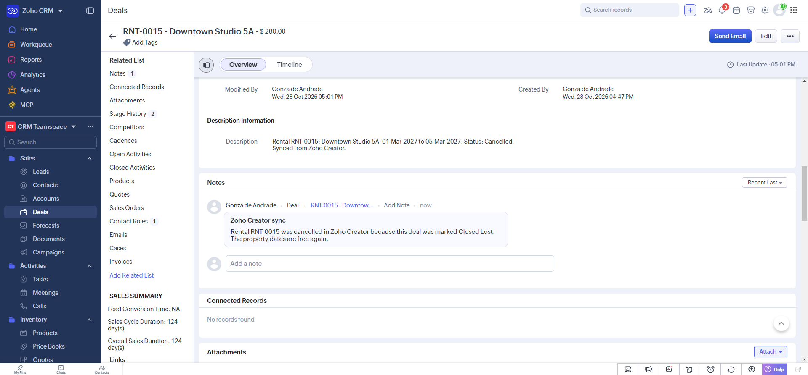 **CRM → Creator**: the Deal was marked Closed Lost, the rental was cancelled in Creator, and the sync left this note | 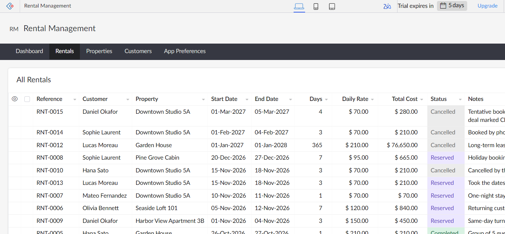 **…and in Creator** the booking is already Cancelled |
| 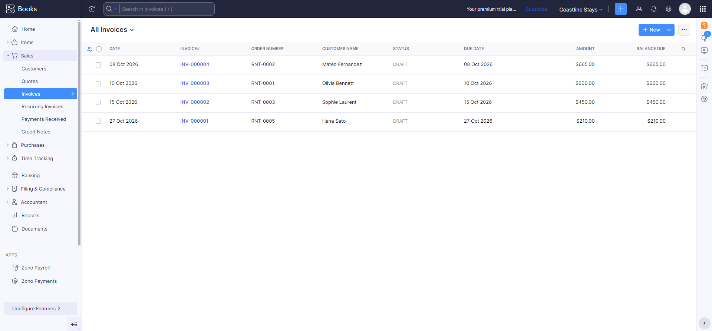 **Zoho Books**: one invoice per completed stay. The total equals the dashboard's Realized Revenue | 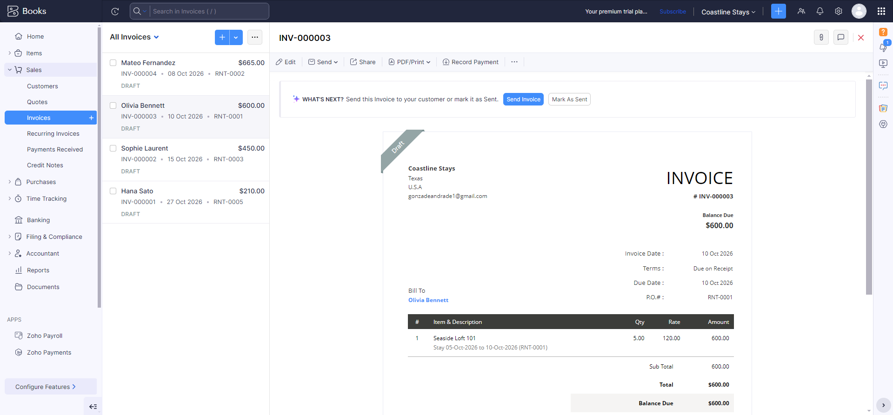 **Invoice**: property, nights × rate, rental reference |

More: [`screenshots/`](screenshots/), including one screenshot per test case in [`screenshots/tests/`](screenshots/tests/).

## Repository structure

```
app/
  RentalManagement.ds              ← the importable Zoho Creator application (generated)
  RentalManagement-no-crm.ds       ← same app without the CRM and Books integrations (generated)
  build.mjs                        ← builds the .ds from the sources below
  src/RentalManagement.template.ds ← forms, reports, page, menu, workflows
  src/deluge/*.dg                  ← Deluge scripts: validation, post-save, CRM sync, Books invoice, email
  crm/deal_closed_lost.dg          ← Zoho CRM function (Deal Closed Lost → cancel rental)
automation/                        ← Playwright scripts: import, seed data, tests, screenshots
test-data/seed-data.json           ← fictional customers and properties
screenshots/                       ← images captured from the live apps
README.md · PROJECT_OVERVIEW.md · DATA_MODEL.md · BUSINESS_RULES.md
TEST_PLAN.md · TEST_RESULTS.md · DEMO_SCRIPT.md
```

## Install it in your own Zoho account

1. `node app/build.mjs` (optional; regenerates `app/RentalManagement.ds` after you edit the sources).
2. In Zoho Creator, go to **Create Application → Import from file → Local storage** and select `app/RentalManagement.ds`.
3. Open the app and add a few customers and properties, or replay the sample data with the scripts in [`automation/`](automation/README.md).

The integrations need three connections, each authorized by the account owner:

| Connection | Created in | Link name used in the code |
|---|---|---|
| Zoho CRM (Creator's built-in connection) | Creator → Microservices → Connections | none: the default CRM connection |
| Zoho Books | Creator → Microservices → Connections | `zoho_books_connection` (needs access to Books contacts and invoices) |
| Zoho Creator | CRM → Setup → Developer Hub → Connections | `creatorrentals` (scopes: `ZohoCreator.report.READ`, `ZohoCreator.report.UPDATE`) |

The Books organization ID is set at the top of `books_invoice.dg`. The CRM side also needs the function from `app/crm/deal_closed_lost.dg` and a workflow rule on Deals (*Stage is modified to Closed Lost* → call the function with the Deal Id). If the importer rejects the integration scripts because a connection isn't set up yet, import `app/RentalManagement-no-crm.ds` (built with `node app/build.mjs --no-crm`) and add the scripts afterwards. Importing into a second account wasn't tested.

The import creates the structure only, not the data. Zoho Creator's Free plan allows a limited number of applications, so you may have to remove an existing one first.

**About the live accounts:** the project was built on trial editions (Creator trial until early November 2026; Books premium trial). Live links may stop working after the trials end. The code, screenshots and test evidence in this repository remain.

## Documentation

| Document | Contents |
|---|---|
| [PROJECT_OVERVIEW.md](PROJECT_OVERVIEW.md) | Business scenario, solution, implemented vs. planned features |
| [DATA_MODEL.md](DATA_MODEL.md) | Forms, fields, relationships, reports, CRM/Books mapping |
| [BUSINESS_RULES.md](BUSINESS_RULES.md) | Calculations, validations, overlap rule, status lifecycle, integrations, KPI definitions |
| [TEST_PLAN.md](TEST_PLAN.md) | Test approach and test cases |
| [TEST_RESULTS.md](TEST_RESULTS.md) | Executed results with evidence |
| [DEMO_SCRIPT.md](DEMO_SCRIPT.md) | Demo video scripts (90-second overview and technical walkthrough) |

## Author

**Gonzalo de Andrade**, Zoho Developer (CRM, Creator, Books, Deluge, integrations) · [GitHub](https://github.com/GonzaloDeAndrade) · [LinkedIn](https://www.linkedin.com/in/gonzalo-de-andrade-20a2791b8/)
